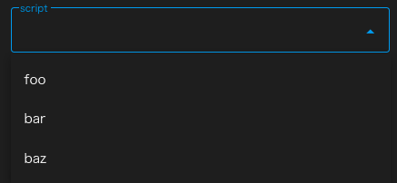
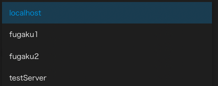
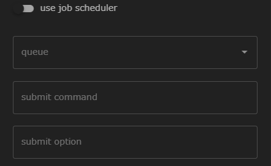
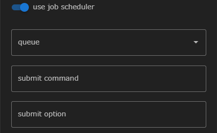
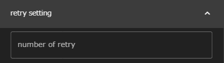
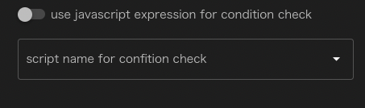
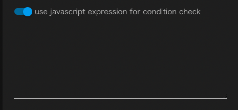
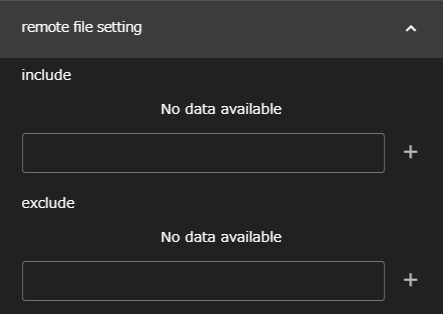
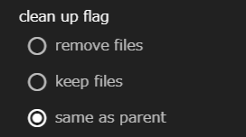

Taskコンポーネントは、WHEELのコンポーネントの中で最も基本的かつ重要なコンポーネントです。  
__script__ プロパティに設定されたスクリプトファイルを、実行環境(host/use job scheduler/queueプロパティ)の設定に応じて実行します。

Taskコンポーネントに指定することのできるプロパティは以下のとおりです。

### script
Taskコンポーネントの実行時に呼ぶスクリプトのファイル名を設定します。



scriptプロパティはセレクトボックスになっており、Taskコンポーネント内に存在するファイルの中から選ぶことができます。

__Taskコンポーネントの実行結果について__  
Taskコンポーネントを実行した際の成否は指定されたスクリプトの戻り値で判定されます。（0:正常終了、0以外:異常終了）  
従いまして、スクリプト内で複数のコマンドを実行する際は適宜、戻り値を指定してください。
{: .notice--info}

### host
scriptの実行環境として、[リモートホスト設定]({{ site.baseurl }}/for_admins/how_to_boot/#リモートホスト設定)にて設定されたリモートホスト、または"localhost"を選択します。



- "localhost"を選択したとき  
scriptがWHEELサーバが動作しているマシン上で実行されます。  
- "localhost"以外を選択したとき  
sshでリモートホストへディレクトリ全体が転送され、scriptがリモートホスト上で実行されます。(後述のuse job schedulerが設定されているときは、scriptはバッチシステムにジョブスクリプトとして投入されます)

### use job scheduler
scriptの実行をバッチシステムに投入する時に有効にします。  
use job schedulerを有効にしたときのみ、次のqueue, submit optionプロパティを設定することができます。

- 無効のとき




- 有効のとき



### queue
ジョブを投入するキューをリモートホスト設定で設定したキューの中から選びます。
無指定の場合はバッチシステムのデフォルトキューに対してジョブを投入します。

### submit command
[リモートホスト設定]({{ site.baseurl }}/for_admins/how_to_boot/#リモートホスト設定) で指定されたバッチシステムにジョブを投入するときのコマンド名が表示されます。
そのため、ここでは変更することはできません。

### submit option
ジョブ投入時に追加で指定するオプションを設定します。

### source script
リモートホストでスクリプトを実行する前に読み込む環境設定ファイルを指定します。
ここで指定したスクリプトは`source`コマンドで読み込まれます。

例えば、特定の環境変数を設定したり、モジュールシステム（Environment Modules等）を使用する場合に利用します。

例:
```bash
# setup.sh の内容
module load intel/2021
export MY_VAR=value
```

### checker script
Taskコンポーネントの成功/失敗を判定するための専用スクリプトを指定します。
checkerスクリプトはTaskコンポーネント実行終了後に実行され、その戻り値（0:成功、0以外:失敗）でTaskの最終的な成否が決定されます。

checkerスクリプトが設定されている場合、scriptプロパティで指定したスクリプトの戻り値は無視され、checkerスクリプトの戻り値が使用されます。

例:
```bash
#!/bin/bash
# 出力ファイルの存在確認
if [ -f output.dat ]; then
  exit 0
else
  exit 1
fi
```

### number of retry
Taskコンポーネントの実行に失敗したときに、自動的に再実行する回数を指定します。
無指定時は再実行しません。



再実行するかどうかの条件を指定したい場合は、次の __script name for condition check__ (または __use javascript expression for condition check__) を併用します。

### script name for condition check / use javascript expression for condition check
Taskコンポーネントが失敗したときに、__再実行するかどうかを判定する__ ためのシェルスクリプトまたはjavascript式を指定します。
Taskの成功/失敗そのものを判定するものではありません。成功/失敗の判定を行うのは、上記の __checker script__ (未設定のときは __script__ の戻り値)です。

|  | 役割 | 実行されるタイミング | 判定結果の意味 |
|---|---|---|---|
| checker script | Taskの最終的な成功/失敗を決める | Taskの実行終了後 | 戻り値 0: 成功 / 0以外: 失敗 |
| script name for condition check | 失敗したTaskを再実行するかどうかを決める | Taskが失敗と判定された後(成功したときは実行されない) | 戻り値 0: 再実行する / 0以外: 再実行しない |

 - __use javascript expression for condition check__ が無効のとき  
 <br/>
無効のときは、シェルスクリプトを選択するドロップダウンリストが表示されます。  
ここで指定されたシェルスクリプトが、Taskが失敗した後に実行され、戻り値が0であれば再実行、0以外であれば再実行せずにTaskを失敗として確定します。

 - __use javascript expression for condition check__ が有効のとき  
<br/>
有効のときは、javascript式を記述することができます。  
ここで入力した式が、Taskが失敗した後に評価され、Truthyな値を返せば再実行、Falsyな値を返せば再実行せずにTaskを失敗として確定します。

スクリプト名、javascript式ともに未設定で、number of retryの値のみを設定していた場合は、Taskが失敗するたびに、number of retryに設定した回数に達するまで再実行を繰り返します。  
条件を指定した場合も、再実行の回数の上限は number of retry で決まります(無指定のときはサーバの設定 `defaultTaskRetryCount` の値が上限になります)。

__利用可能な環境変数について__  
再実行の判定を行うスクリプトやjavascript式では、以下の環境変数を利用できます。
- シェルスクリプトの場合: `WHEEL_TASK_RT`
- javascript式の場合: `wheelTaskRT`

これらの変数には、scriptプロパティで指定されたスクリプトの戻り値が設定されます。
ただし、checkerプロパティが設定されている場合は、checkerスクリプトの戻り値が優先して使用されます。

例: シェルスクリプトで戻り値が10の場合のみ再実行する
```bash
#!/bin/bash
if [ "$WHEEL_TASK_RT" = "10" ]; then
  exit 0
else
  exit 1
fi
```

例: javascript式で戻り値が5未満の場合のみ再実行する
```javascript
wheelTaskRT < 5
```
{: .notice--info}

### continue project execution after failure
Taskコンポーネントが(再実行の回数を使い切った後も)失敗した場合に、プロジェクトの実行を続けるかどうかを指定します。

 - 無効のとき(デフォルト)  
Taskが失敗した時点で、プロジェクト全体の実行が中断されます。実行中や実行待ちの他のコンポーネントも実行されません。

 - 有効のとき  
このTaskが失敗しても、それを理由にプロジェクトを中断せず、他のコンポーネントの実行を続けます。

### include, exclude



Taskコンポーネントをリモートホストで実行した際に生成されたファイルは、output filesに指定されているなど、その後の処理で必要にならない限り、リモートホスト上にそのままの状態で残されます。

そこで、その後のワークフローの処理には不要なものの確認はしたいファイル（実行時にアプリケーションが出力するログファイルなど）は、__include__ に指定します。
すると、Taskコンポーネント実行終了時にWHEELサーバ上にコピーされ、Filesエリアで確認することができます。

__include__ には、ディレクトリ名やglob（ワイルドカード）などを指定することができますが、さらに __exclude__ を指定すればダウンロード対象から除外することができます。

例えば、__include__ に`*.txt`、__exclude__ に`foo.txt`を指定して、実行終了時にfoo.txt, bar.txt, baz.txtが生成されていたとします。
このとき実際にWHEELサーバ上にコピーされるファイルは、bar.txt, baz.txtの2つのみとなります。

### clean up flag
リモートホストでの実行終了後に、リモートホスト上に残されたファイルを削除するかどうかを指定します。



__remove files__ を指定すれば削除、__keep files__ を指定すればリモートホスト上に保存されます。  
デフォルト設定では __same as parent__ が指定されており、上位コンポーネントの設定と同じ動作をします。
なお、最上位コンポーネントで __same as parent__ を指定した場合は、__keep files__ を指定したときと同じ動作になります。


--------
[コンポーネントの詳細に戻る]({{ site.baseurl }}/reference/4_component/)

